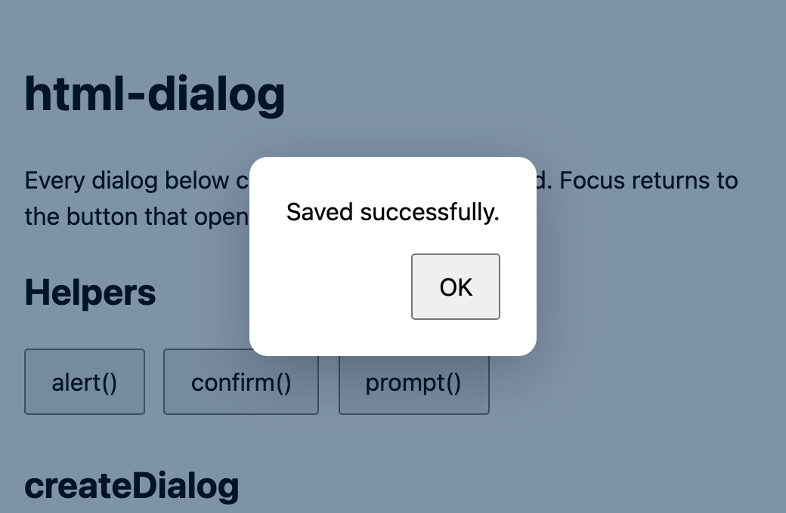
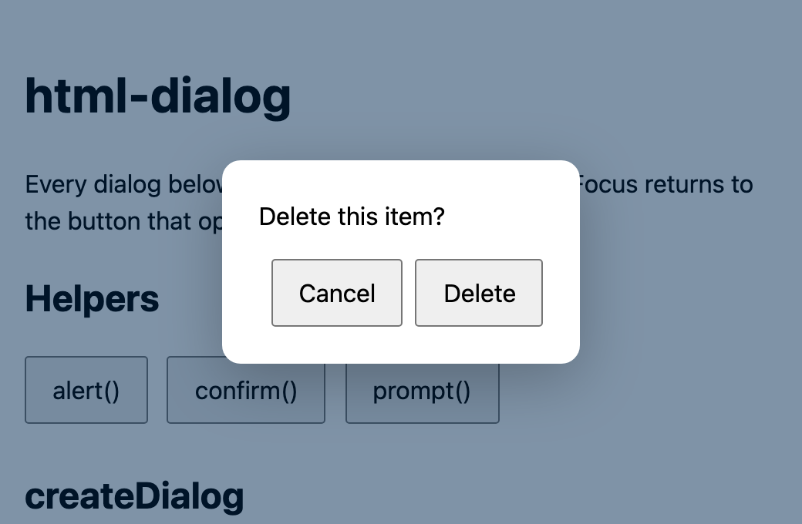
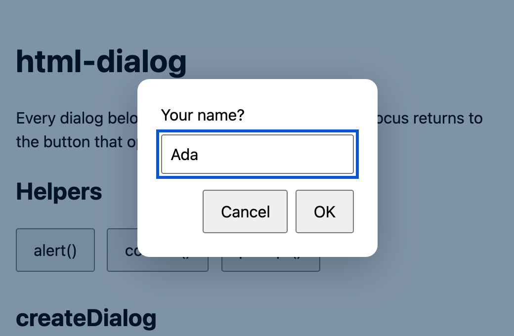
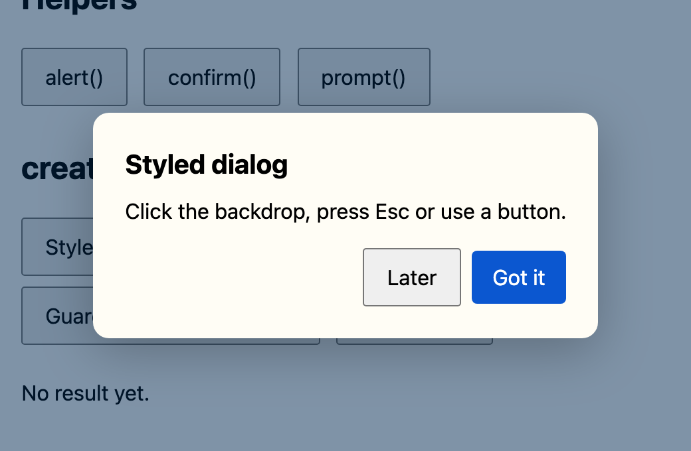

# html-dialog

[](https://github.com/alexwenzel/npm-html-dialog/actions/workflows/ci.yml)
[](https://www.npmjs.com/package/html-dialog)

A tiny (~1.4 kB gzipped), dependency-free, promise-based wrapper around the native
[`<dialog>`](https://developer.mozilla.org/en-US/docs/Web/HTML/Element/dialog) element.
Written in TypeScript, works with any framework or none.

- **Native**: focus trapping, <kbd>Esc</kbd>, backdrop and top layer come from the browser.
- **Promise-based**: `const choice = await dialog.open()`.
- **Safe by default**: strings are inserted as text, never as HTML.
- **Accessible**: the dialog is labelled by its title and described by its content; `alert()` and `confirm()` use `role="alertdialog"`.
- **Styleable**: you bring the CSS, there is none shipped.

<p>
  
  
  
  
</p>

> Upgrading from 0.0.x? See [MIGRATION.md](MIGRATION.md).

## Installation

```sh
npm i html-dialog
```

```js
import { createDialog, confirm } from 'html-dialog'
```

### Without a build step

```html
<script src="https://cdn.jsdelivr.net/npm/html-dialog@0.1/dist/html-dialog.iife.js"></script>
<script>
    HtmlDialog.confirm('Delete this item?').then((ok) => console.log(ok))
</script>
```

or as an ES module:

```html
<script type="module">
    import { confirm } from 'https://cdn.jsdelivr.net/npm/html-dialog@0.1/dist/html-dialog.js'
</script>
```

[unpkg](https://unpkg.com) works the same way. To self-host, download `html-dialog.js` or `html-dialog.iife.js`
from the [GitHub release](https://github.com/alexwenzel/npm-html-dialog/releases).

## Quick start

```js
import { createDialog } from 'html-dialog'

const dialog = createDialog({
    title: 'Delete item?',
    content: 'This cannot be undone.',
    buttons: [
        { text: 'Cancel', value: 'cancel' },
        { text: 'Delete', value: 'delete', autofocus: true },
    ],
})

const choice = await dialog.open() // 'cancel' | 'delete' | '' (Escape)
```

The dialog is created immediately but only added to the DOM on the first `open()`.
Buttons are submit buttons of a `<form method="dialog">` by default, so clicking one closes the dialog and its
`value` becomes the result.

## Helpers

Drop-in replacements for the browser's `alert`, `confirm` and `prompt`. They are tree-shakeable, remove themselves from the
DOM afterwards and accept the same options as `createDialog` (except `content` and `buttons`), plus `okText` and `cancelText`.

```js
import { alert, confirm, prompt } from 'html-dialog'

await alert('Saved.')

if (await confirm('Delete this item?', { okText: 'Delete' })) {
    // ...
}

const name = await prompt('Your name?', {
    defaultValue: 'Ada',
    inputAttributes: { required: '', autocomplete: 'name' },
}) // string, or null if cancelled
```

| helper                       | resolves                                                    |
| ---------------------------- | ----------------------------------------------------------- |
| `alert(message, options?)`   | `void` when dismissed                                       |
| `confirm(message, options?)` | `true` for OK, `false` for Cancel, <kbd>Esc</kbd>, backdrop |
| `prompt(message, options?)`  | the entered `string`, or `null` if cancelled                |

`prompt` additionally takes `defaultValue` and `inputAttributes` (attributes set on the `<input>`).

## API

### `createDialog(options): DialogInstance`

| option            | type                                       | default         | description                                                                                  |
| ----------------- | ------------------------------------------ | --------------- | -------------------------------------------------------------------------------------------- |
| `content`         | `string \| Node`                           | **required**    | Dialog body. Strings are inserted as text.                                                   |
| `title`           | `string \| Node`                           | -               | Title, also used as the accessible name.                                                     |
| `html`            | `boolean`                                  | `false`         | Insert string `title` / `content` as HTML. Only for trusted input.                           |
| `buttons`         | `ButtonOptions[]`                          | `[]`            | See below.                                                                                   |
| `role`            | `'dialog' \| 'alertdialog'`                | `'dialog'`      | Use `alertdialog` for messages that demand a response.                                       |
| `modal`           | `boolean`                                  | `true`          | `showModal()` vs. `show()`.                                                                  |
| `closeOnEscape`   | `boolean`                                  | `true`          | Allow closing with <kbd>Esc</kbd>.                                                           |
| `closeOnBackdrop` | `boolean`                                  | `false`         | Close when the backdrop is clicked.                                                          |
| `destroyOnClose`  | `boolean`                                  | `false`         | Remove the dialog from the DOM after closing.                                                |
| `appendTo`        | `Element`                                  | `document.body` | Where to insert the dialog on first open. Shadow roots work.                                 |
| `classNames`      | `{ dialog, title, content, buttons }`      | -               | CSS classes per part (all optional).                                                         |
| `onOpen`          | `(dialog) => void`                         | -               | Called after opening.                                                                        |
| `beforeClose`     | `(returnValue, dialog) => boolean \| void` | -               | Called before closing (button, <kbd>Esc</kbd>, backdrop, `close()`). Return `false` to veto. |
| `onClose`         | `(returnValue, dialog) => void`            | -               | Called after closing.                                                                        |

### `ButtonOptions`

| option      | type                                       | default      | description                                                       |
| ----------- | ------------------------------------------ | ------------ | ----------------------------------------------------------------- |
| `text`      | `string`                                   | **required** | Button label.                                                     |
| `value`     | `string`                                   | `''`         | Becomes the dialog's return value.                                |
| `type`      | `'submit' \| 'button' \| 'reset'`          | `'submit'`   | `submit` closes the dialog and runs form validation.              |
| `autofocus` | `boolean`                                  | `false`      | Focus this button on open.                                        |
| `className` | `string`                                   | -            | CSS classes.                                                      |
| `onClick`   | `(event, dialog) => void`                  | -            | Click handler. `event.preventDefault()` keeps the dialog open.    |
| `on`        | `{ [eventName]: (event, dialog) => void }` | -            | Handlers for any other DOM event, e.g. `{ mouseenter, keydown }`. |

### `DialogInstance`

| member                    | description                                                                                                      |
| ------------------------- | ---------------------------------------------------------------------------------------------------------------- |
| `open(): Promise<string>` | Opens the dialog. Resolves with the return value when it closes. Calling it while open returns the same promise. |
| `close(returnValue?)`     | Closes the dialog (respects `beforeClose`).                                                                      |
| `destroy()`               | Closes if needed, removes the element and detaches all listeners. Further `open()` / `close()` throw.            |
| `element`                 | The `HTMLDialogElement`.                                                                                         |
| `form`                    | The inner `HTMLFormElement`.                                                                                     |
| `isOpen`                  | `true` while open.                                                                                               |

### Generated markup

```html
<dialog class="…" aria-labelledby="html-dialog-1-title" aria-describedby="html-dialog-1-content">
    <form method="dialog">
        <div id="html-dialog-1-title" class="…">Title</div>
        <div id="html-dialog-1-content" class="…">Content</div>
        <div class="…">
            <button type="submit" value="ok" class="…">OK</button>
        </div>
    </form>
</dialog>
```

## Recipes

### Form with validation

Submit buttons use the browser's built-in validation, so a `required` input blocks closing until it is filled.

```js
const input = Object.assign(document.createElement('input'), { name: 'email', type: 'email', required: true })
const label = document.createElement('label')
label.append('Email: ', input)

const dialog = createDialog({
    title: 'Subscribe',
    content: label,
    destroyOnClose: true,
    buttons: [
        { text: 'Cancel', type: 'button', onClick: (_, d) => d.close('cancel') },
        { text: 'Subscribe', value: 'ok' },
    ],
})

if ((await dialog.open()) === 'ok') subscribe(input.value)
```

Keep cancel as `type: 'button'`: the first submit button is the one <kbd>Enter</kbd> triggers, and cancelling should skip validation.

### Prevent accidental closing

```js
createDialog({
    content: 'You have unsaved changes.',
    beforeClose: (value) => value === 'discard' || confirmedElsewhere(),
    buttons: [{ text: 'Discard', value: 'discard' }],
}).open()
```

### Styling

No CSS is included. Use `classNames` and the native `::backdrop`:

```css
.my-dialog {
    border: 0;
    border-radius: 0.75rem;
    padding: 1.5rem;
}
.my-dialog::backdrop {
    background: rgb(0 0 0 / 0.5);
}
```

```js
createDialog({ content: 'Hi', classNames: { dialog: 'my-dialog' } })
```

### Non-modal

`modal: false` uses `show()`: no backdrop, no focus trap, the page stays interactive.

See [demo/index.html](demo/index.html) for a runnable page (`npm run dev`).

## Accessibility

- The dialog is named by its title (`aria-labelledby`) and described by its content (`aria-describedby`). Give every dialog a `title`.
- `alert()` and `confirm()` use `role="alertdialog"`. Set `role` yourself for custom alerts.
- Modal dialogs trap focus, close with <kbd>Esc</kbd> and return focus to the previously focused element natively.
- Use `autofocus` on the safest or most expected action; for destructive confirmations avoid focusing the destructive button.
- Style focus indicators and respect `prefers-reduced-motion` in your own CSS.

## Security

`title` and `content` strings are inserted with `textContent`. Pass DOM nodes for rich content, or opt into `html: true` only with trusted or sanitized markup.

## Browser support

All browsers with `HTMLDialogElement` (Chrome/Edge 37+, Firefox 98+, Safari 15.4+). `beforeClose` on <kbd>Esc</kbd> relies on the `cancel` event; some browsers may close on a repeated <kbd>Esc</kbd> regardless.

## Development

```sh
npm ci
npx playwright install chromium
npm run dev        # demo
npm test           # vitest in real Chromium, with coverage
npm run lint && npm run typecheck && npm run build && npm run size
```

Release: `npm version minor && git push --follow-tags` – CI tests, publishes to npm and creates the GitHub release.

## License

[MIT](LICENSE)
